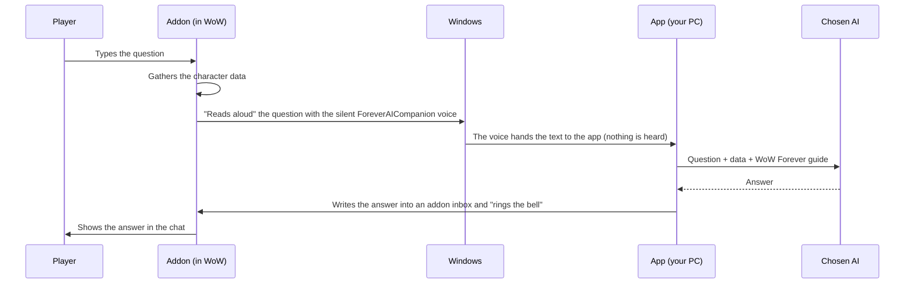

> **Fork notice:** this is an independently maintained fork of [lucasmenares/forever-ai-companion](https://github.com/lucasmenares/forever-ai-companion) (MIT). Releases and updates here come from this fork only.

<p align="center">
  
</p>

<h1 align="center">Forever AI Companion</h1>

<p align="center">
  Your AI assistant inside <b>World of Warcraft: Forever</b>.<br>
  Ask anything without leaving the game: the AI already knows your character.
</p>

<p align="center">
  <a href="https://github.com/nullgatestudios/forever-ai-companion/releases/latest/download/ForeverAICompanion.exe"><b>⬇ Download for Windows</b></a>
  &nbsp;·&nbsp;
  <a href="https://github.com/nullgatestudios/forever-ai-companion/releases/latest/download/ForeverAICompanion-mac.zip"><b>⬇ Download for Mac</b></a>
</p>

<p align="center"><sub>The addon is also on <a href="https://www.curseforge.com/wow/addons/forever-ai-companion">CurseForge</a>, but you still need the app: it's the one that talks to the AI.</sub></p>

<p align="center"><sub>English and Spanish · Inglés y español</sub></p>

<p align="center"><sub>Unofficial fan project, not affiliated with Blizzard. Use it at your own risk: <a href="#blizzards-rules-and-your-own-risk">read the risks</a>.</sub></p>

<p align="center">
  
  <br>
  <sub>Ask Fizzi anything: the answer uses your own level, quests, location, bags and gear. Link items with shift-click, and the assistant links items back in its answers.</sub>
</p>

---

## Contents

- [What it is](#what-it-is)
- [Installation (3 minutes)](#installation-3-minutes)
- [Using it in the game](#using-it-in-the-game)
- [Which AI to choose](#which-ai-to-choose)
- [Languages](#languages)
- [How it works](#how-it-works)
- [The WoW Forever guide and its updates](#the-wow-forever-guide-and-its-updates)
- [Privacy and safety](#privacy-and-safety)
- [Blizzard's rules and your own risk](#blizzards-rules-and-your-own-risk)
- [FAQ and troubleshooting](#faq-and-troubleshooting)
- [Uninstalling](#uninstalling)
- [For developers](#for-developers)

---

## What it is

Forever AI Companion has two parts that work together:

| Part | Where it lives | What it does |
|---|---|---|
| **The addon** | Inside WoW Forever | The minimap button, the chat window and your assistant. It reads your character's data and shows the answers. Also on [CurseForge](https://www.curseforge.com/wow/addons/forever-ai-companion). |
| **The app** (`ForeverAICompanion.exe` / `Forever AI Companion.app`) | On your Windows PC or your Mac | Receives your question, asks the AI you chose and sends the answer back to the game. |

With every question the AI receives, without you having to explain anything:

- your **character**: race, class, level, experience (rested XP in points and as a share of the level), talents and stats;
- your **gear** slot by slot with its effects ("Equip:", "Use:", set bonuses), what's in your **bags** and your bank;
- your **pet**: its abilities with rank and autocast, stance, loyalty, training points, diet and stats, plus what **Beast Training** can teach it;
- your **spells**, which ones are not on your **action bars** yet, and your weapon skills;
- **where you are**: zone and coordinates, and the flight paths you know;
- your **quests** with progress, rewards and the real coordinates of where to do them;
- your **target** (family, whether it counts for a quest, its tooltip), recent error messages and deaths;
- **professions**, reputations, dungeon lockouts and group;
- the **items you link** in the question, the **window you have open** (a quest, a vendor, a trainer, Beast Training, the flight map, the auction house, loot), your **recipes** and the **auction prices** you have seen for the items you own.

So you can ask things like *"What should I do now?"*, *"Is this ring better?"* or *"Which dungeon should I run?"* and get an answer for **your** character.

You get an assistant with personality: **Fizzi**, a gnome inventor, for the Alliance, or **Rizzik**, a goblin dealer, for the Horde.

---

## Installation (3 minutes)

**Requirements:** Windows 10 or 11, or a Mac with macOS 13 Ventura or later ([Mac steps](#on-a-mac)), WoW Forever installed, and an AI (see [Which AI to choose](#which-ai-to-choose): with Claude Pro/Max or ChatGPT Plus/Pro you pay nothing extra).

### 1. Download and open the app

1. Download [**ForeverAICompanion.exe**](https://github.com/nullgatestudios/forever-ai-companion/releases/latest/download/ForeverAICompanion.exe).
2. Double-click the file.

> **Does "Windows protected your PC" appear?** That's normal for new programs that don't have a digital signature yet. Click **More info** and then **Run anyway**.

The app installs itself for your user (no permissions needed), creates a **Forever AI Companion** shortcut on the desktop and in the Start menu, and opens its window. You can delete the downloaded file afterwards.

### 2. Follow the app's setup

The window guides you step by step:

| Step | What to do |
|---|---|
| **Your game** | It usually finds WoW Forever by itself. If not, click **Choose folder…** and pick the *World of Warcraft* folder. |
| **The addon** | Click **Install the addon**. |
| **Your AI** | Choose who answers (see [Which AI to choose](#which-ai-to-choose)), follow the steps shown and click **Save and test**: you'll see a sample answer. |
| **Invisible sending** (optional, recommended) | Choose how your question travels from the game to the app ([explained below](#how-your-question-travels-invisible-or-on-screen-line)). |
| **Done** | Leave **Open when Windows starts** on so you never have to remember to open the app. |

> **Got the addon from CurseForge?** You still need the app: addons can't use the internet, so without the app nobody answers your questions. Install the app as above and click **Install the addon** in it anyway: it creates the inboxes the answers arrive through (the app makes them on your PC). The app keeps the addon up to date by itself.

### 3. Restart WoW

If the game was open, **close it completely and open it again** (`/reload` is not enough the first time).

### On a Mac

The Mac app works exactly like the Windows one, invisible sending included. Requirements: macOS 13 Ventura or later, on Apple silicon or Intel.

1. Download [**ForeverAICompanion-mac.zip**](https://github.com/nullgatestudios/forever-ai-companion/releases/latest/download/ForeverAICompanion-mac.zip) and double-click it: you get **Forever AI Companion**.
2. Open it. The first time macOS says it can't check it for malware (the app isn't notarized by Apple yet): click **Done**, then go to **System Settings › Privacy & Security**, scroll down and click **Open Anyway** next to *Forever AI Companion*. You only do this once.
3. The app moves itself to the **Applications** folder of your user (no password needed) and opens its window. Follow the same setup as on Windows.

Differences from Windows:

| | Mac |
|---|---|
| Where the app lives | In your Applications folder, and **in the menu bar** (top right) while it runs, instead of next to the clock |
| Invisible sending | Already on: the silent voice comes inside the app and needs **no permission**. You can turn it off in the setup or the dashboard |
| On-screen line | Needs the **Screen Recording** permission (macOS asks once). WoW must not be minimized when you ask |
| Open when you log in | The **Open when you log in to your Mac** switch (it shows up in *System Settings › General › Login Items*) |
| Signing in to Claude Code / Codex | Happens in a **Terminal** window the app opens |

### Updating

**From version 1.7.0 on, the app updates itself.** Every few hours it checks this repository for a new release. When there is one, you get a notice next to the Windows clock and an **Update now** button in the app's dashboard: one click downloads it, checks that it is exactly the file published here (SHA-256), and restarts the app with the new version, keeping your chats, settings and keys. The addon is updated with it (restart WoW or `/reload` afterwards).

For older versions, download the new `.exe` and open it: it replaces the old version in the same way.

**Updating to 1.10.1 with invisible sending on:** it keeps working, but this version moves the silent voice to a protected Windows folder. You get a notice next to the clock and at the top of the dashboard: click **Update invisible sending**, accept the Windows prompt, and restart WoW.

The WoW Forever guide the AI uses updates by itself from the internet, with nothing to download.

Coming from version 1.5.0 or earlier, the app and the addon move to new folder names on their own: your chats, settings and API keys come along. Restart WoW once afterwards. If you use invisible sending, the app window will offer **Update invisible sending** (Windows asks for permission once); until then it keeps working as before.

---

## Using it in the game

1. **Click the minimap button**: the circle with your assistant's portrait, on the edge of the minimap like other addons' buttons. Drag it to slide it around the minimap.
2. **The first time, choose your assistant**: Fizzi (Alliance) or Rizzik (Horde). It suggests the one for your faction.
3. **Type your question** and click Send. The answer arrives in a few seconds; if the window was closed, you get a notification.

- **Chats by topic**: each chat remembers its conversation (gear, quests, dungeons…). Right-click the minimap button to start a new chat.
- **Ask about a specific item**: while typing, shift-click an item (in your bags, a vendor, a quest reward…) to put it in the question, like in the chat box: *"Is [this ring] better than mine?"*. The AI gets its full stats, and the link stays clickable in your message.
- **Clickable items in the answers**: when the assistant names an item from your gear, bags, bank, quest rewards or an open vendor, it shows up as a real item link. Hover it for the tooltip, click to open it, shift-click to paste it in the chat or ctrl-click to try it on. Items that aren't in your data (for example, dungeon loot) are written as plain text.
- **Ask about what's open**: with a quest, vendor, trainer, Beast Training, flight map, auction house or loot window open, the AI sees it, and a new chat suggests questions about that window. Try *"Should I accept this quest?"*, *"Which reward should I pick?"*, *"What should I buy here?"*, *"What should I teach my pet?"* or *"What from my bags should I sell here?"*.
- **Auction prices**: every price you see at the auction house is remembered (per realm and faction), so later the AI can tell you what your items are worth even with the auction house closed.
- **Professions**: open each profession window once and the addon remembers your recipes, so you can ask *"What can I craft with what I have?"* or *"Which recipe should I make to level up?"*.
- **Is the app ready?** The line under the chat title tells you. Green: the app is open and ready. Red: questions won't be answered yet, and it says why (the app is closed or not responding, no AI is chosen, or your AI needs you to sign in). Hover it for what to do.
- **Tokens used**: next to each answer's time you see how many tokens it used (*"18.2k tokens"*), and under the text box, below **Send**, the whole chat's total. Hover them for the detail: tokens read (your data, the guide and what it looked up; the part from the cache counts much less) and written. It's what your plan or API key is measured in. The dashboard's recent questions show it too.
- **See what is sent**: in the window click **See the data I send**.
- **In combat** you can still ask, but keep your eyes on the game: while you're in combat a red bar in the window reminds you, and the window's edge flashes red each time you get hit.

### Chat commands (optional)

Every command also works with its Spanish word (shown in parentheses).

| Command | What it does |
|---|---|
| `/ia` or `/ai` | Opens or closes the window |
| `/ia <question>` | Asks directly in the open chat |
| `/ia new` (`nuevo`) | Starts a new chat |
| `/ia assistant` (`asistente`) | Choose between Fizzi and Rizzik (`/ia assistant fizzi` or `/ia assistant rizzik`) |
| `/ia button` (`boton`) | Shows or hides the minimap button (`/ia button reset` puts it back in place) |
| `/ia sound` (`sonido`) | Turns the answer notification sound on or off |
| `/ia data` (`datos`) | Shows the data that is sent |
| `/ia status` (`estado`) · `/ia inbox` (`buzon`) | Diagnostics: connection status and check for pending answers |
| `/ia help` (`ayuda`) | List of commands |

---

## Which AI to choose

| Option | For whom | Cost | Searches the internet |
|---|---|---|---|
| **My Claude subscription** (recommended) | You have Claude Pro or Max | Included in your plan | Yes |
| **My ChatGPT subscription** | You have ChatGPT Plus or Pro | Included in your plan | Yes |
| **Claude with an API key** | No subscription | Pay per use (≈ 1 US cent per question) | Yes |
| **ChatGPT with an API key** | No subscription | Pay per use | No |
| **Gemini** | You want to try it for free | Free usage with limits | No |
| **AI on your PC (Ollama)** | You have a powerful PC | Free, no internet | No |
| **Test mode** | Check that the game and the app are connected | Free (not an AI) | — |

With the subscriptions, the app installs the official program (**Claude Code** by Anthropic or **Codex** by OpenAI) and opens your browser to sign in. Your questions count toward your plan's usage limit.

You can change the AI or the model at any time from the app's dashboard (**Change**, next to *Artificial intelligence*).

---

## Languages

Everything is available in **English and Spanish**, chosen automatically:

| Part | Language |
|---|---|
| The addon (window, button, assistant, commands) | Your WoW client's language: Spanish for `esES`/`esMX`, English for everything else |
| The app window and the tray icon | Your Windows language: Spanish if Windows is in Spanish, English otherwise |
| The AI's answers | The language of your question, using the names your game client shows (zones, quests, items) |

To force the app's language, set `"language": "en"` or `"es"` in `%APPDATA%\ForeverAICompanion\config.json` (`"auto"` by default).

---

## How it works

For safety, WoW addons **cannot use the internet or write files**. So the question needs a way out of the game and the answer a way back in:



### Going out: from the game to the app

1. The addon puts your question and the character data into a JSON. To keep it light, sections that didn't change since the last question (gear, talents…) are sent only as a fingerprint, and the app fills them in from its copy.
2. It packs it with a `FAIC` mark, its length and a checksum, and sends it by one of two paths:

#### How your question travels: invisible or on-screen line

| | **Invisible** (recommended) | **On-screen line** |
|---|---|---|
| How it works | Windows has voices to read text aloud (like Narrator). The app adds a **silent** voice called *ForeverAICompanion*. The addon "reads" your question with that voice and, instead of making a sound, the voice hands it to the app. | The addon draws a thin line of dark squares along the top edge for ~0.35 s. The app reads it from the game window, like a QR code. |
| What you see or hear | Nothing | A brief flicker at the top of the screen |
| Requirements | Administrator permission once (Windows only allows adding voices that way) | WoW visible when asking (not minimized or covered) |
| What gets installed | A silent voice in Windows' voice list | Nothing |

**On a Mac** the game reads text aloud with macOS's speech system, which lets apps bring their own voices: the silent voice is a speech synthesis extension inside the app (`Forever AI Companion.app/Contents/PlugIns`), so nothing is installed elsewhere and no permission is needed. It runs in macOS's sandbox, which only lets it write into `~/Library/Application Support/ForeverAICompanion/tts-inbox/`. The on-screen line is read from the game window with ScreenCaptureKit.

Technically, on Windows the voice is a small SAPI engine that the app compiles on your PC with the C# compiler included in Windows. When the game asks it to speak, it saves the text in `%APPDATA%\ForeverAICompanion\tts-inbox\` instead of producing audio. Messages travel in chunks of up to 24,000 characters (a normal question is a single one) (`FAIC:<id>:<part>/<total>:<data>`) and the app joins them back.

### Coming back: from the app to the game

- Installing the addon creates **50 "inbox" addons** (`ForeverAICompanion_S01` … `S50`) that the game loads only on request. The app writes the answers into them.
- To signal an answer, the app "rings a bell": 500 `sig/NNN.wav` files start empty, and the app turns the next one into a 50 ms silent sound. Every 2 seconds the addon tries to play it; if it can, it stops it instantly and loads the next inbox, which reads the freshly written answer.
- Each inbox can be loaded once per session (that's why there are 50; `/reload` resets them). If the game's sound is off, the addon checks the inboxes on a timer.
- The same trick tells the game whether the app is ready (the line under the chat title). While the app runs it switches every 3 seconds which of `sig/beat1.wav` and `sig/beat2.wav` plays; both silent means it is closed, one stuck means it crashed or froze. `need-ai.wav`, `need-login.wav` and `problem.wav` say why it can't answer yet, and `st.wav` (always playing) shows the files existed when the game started.

That's why you need to **restart WoW** after installing: the game only sees files that existed when it started.

### What the AI receives

- **The assistant's instructions**: Fizzi's or Rizzik's personality, how to read the data and how to answer (short, with coordinates, no web links because the game can't open them). Items it saw in your data come back marked with their id (`{{item:ID|Name}}`) and the addon turns them into item links, only if that id really is the item with that name in your game.
- **Today's date and the game version**, to reason about the calendar and patches.
- **The WoW Forever guide** (see below): the base guide, plus the detailed sections that match the question (a dungeon, a zone, a class...).
- **Your data and the question**, plus the earlier questions of the same chat.
- If the AI can, it **searches the internet** for whatever the guide doesn't cover (a few seconds more), with its own search tools: it's told to prefer WoW Forever guides (Wowhead, Warcraft Tavern, Method, Maxroll, the Fextralife wiki) and to search before saying it doesn't know something. It can be turned off in the dashboard.

With the subscriptions, Claude Code and Codex run as a plain chat: our instructions replace their coding ones, with no access to your files or commands, without your settings and without saving sessions.

---

## The WoW Forever guide and its updates

WoW Forever launched on November 4, 2026, after the AIs were trained, so they don't know it from memory. That's why the AI receives a **WoW Forever base guide**: zones, dungeons with their levels, raids, the Skyborne race, system changes and the calendar. It's written in English and includes the Spanish client names (`es: ...`) so Spanish players get the names they see.

The guide is the file [`companion/knowledge-builtin/wow-forever.md`](companion/knowledge-builtin/wow-forever.md) in this repository. It starts with a header:

```
---
date: 2026-11-13       ← when it was last reviewed
gameVersion: 1.60.1    ← game version it describes
build: 70938           ← the game's build number
---
```

**How it stays current:**

- The app ships with a copy, and also **downloads the one in this repository** at startup, every 6 hours and as soon as it notices the game was updated. It only uses it if it's valid and its `date` is newer; offline it uses the last one it downloaded.
- The guide and its topics reach the AI fenced off as reference data: they can supply facts, but text inside them cannot change the AI's rules or role.
- The AI knows today's date and how old the guide is. If the guide is more than 21 days old, or the game is newer than the guide, it checks on the internet whatever changes with patches before stating it.

**To update the guide for every player** (without releasing a new version of the app):

1. Open [`companion/knowledge-builtin/wow-forever.md`](companion/knowledge-builtin/wow-forever.md) on GitHub and click the pencil (*Edit*).
2. Make your changes and **set `date` to today** (and `gameVersion` and `build` if there was a patch; the build is shown by `/ia data` in the game, in the *client* section).
3. Click **Commit changes**. Within a few hours every app downloads it (or right away with **Check for updates** in the dashboard).

Tips: write full dates ("opened on December 9, 2026", not "opening soon"), mark with "per guides" whatever Blizzard hasn't confirmed, and keep it under 200 KB.

**Detailed topics.** Next to it, [`companion/knowledge-builtin/wow-forever-topics.md`](companion/knowledge-builtin/wow-forever-topics.md) holds the details: every dungeon and raid (location, how to get in, bosses, loot, quests), zones and leveling, classes and races, professions and systems. It's too long to send whole, so with each question the AI gets only the sections that match it. Each section starts with a `### Title` and a `keywords:` line with the English and Spanish names a player might type (the section is picked when the question contains one of them or names something written in the section, like an item or an NPC, and a little when it's the player's zone, race or class); `keywords: always` sends a section with every question. It has the same header and is updated the same way (set its `date` to today), and it's downloaded by app version 1.10.0 or later; older versions only use the base guide.

Each player can also add their own knowledge from the app's dashboard (**Server knowledge…**): `.md` or `.txt` files in that folder are included with every question and take priority over the guide.

---

## Privacy and safety

- **Your data only goes to the AI you chose.** This project has no servers: it never receives your questions, your data or your keys.
- The app's only connection of its own is downloading the WoW Forever guide from this repository (a read, nothing is sent). Internet searches are made by the AI you chose, with its own tools.
- API keys are stored only on your PC, in `%APPDATA%\ForeverAICompanion\config.json`, **encrypted with Windows DPAPI** for your Windows account: a copy of that file on another PC or account doesn't reveal them. Keys saved in plain text by earlier versions are encrypted the next time the app starts. On a Mac they are in `~/Library/Application Support/ForeverAICompanion/config.json`, encrypted (AES-256-GCM) with a key kept in your **login Keychain** (*Forever AI Companion (API keys)*), with the same protection.
- **Invisible sending:** the silent voice's file used by elevated programs lives in `%ProgramFiles%\ForeverAICompanion`, which only administrators can change (installs from before this change are offered **Update invisible sending** to move it). The voice keeps only this app's own messages: anything else any program speaks with it is dropped without being written or logged.
- **Codex:** when the app searches the PC for Codex, or installs it, it only runs a `codex.exe` that Windows confirms is signed by OpenAI. If a future Codex stops accepting one of the safety switches the app relies on (no commands, no file or browser access), the app refuses to use it rather than dropping the switch.
- The `/ia probe` channel test only watches the game's files while a test is running (and for 15 minutes after, for files the game writes at logout).
- The app window is a local page (`127.0.0.1`) that doesn't accept connections from other computers or other web pages.
- **The game is not modified**: its memory and files are not touched, and the addon doesn't play for you. It only uses normal addon and Windows features.
- This is not a Blizzard product. Use it at your own risk (see the next section).

---

## Blizzard's rules and your own risk

> **Forever AI Companion is an unofficial fan project. It is not made, endorsed or approved by Blizzard Entertainment. You use it at your own risk, and the project is provided as is, with no warranty of any kind.**

Blizzard doesn't review or pre-approve addons or the apps that go with them, so nobody can promise you that using this one will never have consequences for your account. This section explains how the project compares with Blizzard's rules as we read them, and where the risks are, so you can decide for yourself. It is not legal advice and it is not Blizzard's opinion.

### Blizzard's addon policy

Blizzard's [UI Add-On Development Policy](https://us.forums.blizzard.com/en/wow/t/ui-add-on-development-policy/24534) sets the basic rules for addons:

| Rule | This project |
|---|---|
| Addons must be free | ✅ Free, with nothing paid or locked |
| The code must be fully visible | ✅ Readable, unobfuscated Lua. The app's code is in this repository too |
| No harm to realms or other players | ✅ It sends nothing to the realm or to other players during normal use (the optional `/ia probe` test whispers one message to yourself) |
| No ads and no donation requests in the game | ✅ None |
| No offensive content | ✅ None |
| Blizzard may disable any addon feature | Applies, see the risks below |

### Blizzard's Terms of Use

Blizzard's Terms of Use and EULA forbid bots, cheats and unauthorized third-party software that plays for you or collects information from the game. This is what the project does and doesn't do:

| | |
|---|---|
| Plays for you, presses keys or clicks | **No.** You type every question, and every answer is just text you read, like looking something up on a website. |
| Reads or changes the game's memory | **No.** It doesn't read, inject into or modify the game process. |
| Changes the game's files | **No.** The app only writes inside its own addon folders in `Interface\AddOns`. |
| Works during combat | **You can ask, but it only shows text.** It never acts in the game for you. While you're in combat the window shows a red "In combat" bar and flashes when you get hit, so your attention goes back to the game. Versions before 1.11.1 refused questions in combat: asking for advice in the middle of a fight is the closest this project gets to what Blizzard doesn't want addons to give, so keep that in mind. |
| Can be inspected | **Yes.** All of the code is public in this repository. |

### Where the risks are

1. **The way data leaves the game is unusual.** Addons can't use the internet or write files, so the question leaves the game through the silent Windows voice or a line of squares read from the screen, and the answer comes back through addon files and silent sounds (see [How it works](#how-it-works)). These are all normal addon and Windows features, but Blizzard didn't design them for this. Apps that write data for an addon to read have been common and tolerated for years (the TradeSkillMaster desktop app, the WeakAuras Companion, Raider.IO). Reading data off the screen, though, is also a technique cheating bots have used. Those bots are banned for playing automatically, which this app never does, but someone reviewing it could still lump them together.
2. **Blizzard can break it at any time.** If Blizzard doesn't like this kind of tool, the most likely result is a game patch that closes one of these paths, for example by limiting the text-to-speech or sound functions, rather than action against accounts. Blizzard already restricted combat addons heavily in Midnight, the engine WoW Forever runs on. If that happens, the assistant stops working until another way is found, if one exists.
3. **Action against your account is possible.** Because it doesn't automate anything or touch the game's memory, we consider the risk low, but Blizzard has the final word on what its Terms of Use allow, and its rules and how it enforces them can change. If your account matters more to you than the convenience, don't use it.
4. **The AI can be wrong.** Answers can be inaccurate or out of date, especially about things that change with patches. Double-check before spending a lot of gold or time on an answer.
5. **Your AI provider's terms apply too.** Using Claude, Codex or an API key through this app is subject to that provider's own terms and limits.

---

## FAQ and troubleshooting

**How much does it cost?**
The app is free. With your Claude or ChatGPT subscription you pay nothing extra (questions count toward your plan's limit). With an API key you pay per use.

**The answer doesn't arrive.**
- Look at the line under the chat title in the game: if it's red, it says what's wrong.
- Open the app and check that it says **Running** at the top.
- If you just installed the addon or invisible sending, close WoW completely and open it again.
- Type `/ia inbox` in the game to check for new answers.
- With the on-screen line, WoW must be visible when asking and in windowed or "fullscreen (windowed)" mode.

**I can't see the minimap button.**
You may have hidden it (Shift + right-click). Type `/ia button`, or `/ia button reset` to put it back in place.

**The AI test fails.**
Check the steps in *Your AI*: the program must be installed and signed in, or the key must be complete. The error message tells you what's missing.

**Does the app need to stay open?**
Yes, while you play. When you close its window it can keep running next to the Windows clock (click the icon to open it again; right-click to close it). With **Open when Windows starts** you don't have to remember.

**Does it work on Mac?**
Yes, from version 1.11.0: macOS 13 Ventura or later, Apple silicon or Intel. See [On a Mac](#on-a-mac).

**Mac: "Forever AI Companion" can't be opened / Apple can't check it.**
That's macOS protecting you from apps that aren't notarized yet. Go to **System Settings › Privacy & Security** and click **Open Anyway** (once). Updates installed from inside the app don't ask again.

**Mac: the game doesn't see the invisible voice.**
Close WoW completely and open it again. Then type `/ia test-voice` in the game: *ForeverAICompanion* must be in the list. If it isn't, open the app (it registers the voice every time it starts) and check that invisible sending is on in the dashboard.

---

## Uninstalling

Open the app and, under **More options**, click **Uninstall**. It removes the addon, the inboxes, the invisible voice, your settings, the shortcuts and the program. On a Mac it also removes the app from the Applications folder, its login item and its Keychain item.

---

## For developers

### Structure

```
addon/ForeverAICompanion/   Addon (Lua 5.1, modern client, interface 16001)
  Locale.lua                English and Spanish texts (by the client's language)
  Collect.lua               Reads the character's data (each section separately),
                            linked items, open windows and recipes
  Uplink.lua                Game → app: builds the package and picks the path
  Voice.lua                 Invisible path (text to speech with the silent voice)
  Live.lua                  App → game: inboxes and bell
  UI.lua Button.lua         Chat window (and the combat warning) and minimap button
  Chats.lua Notify.lua      Conversations and notifications
  Personas.lua              Fizzi and Rizzik
  Core.lua                  Events and /ia commands
companion/
  src/app/                  App: main (self-install, tray), controller,
                            server (local window), system (Windows, macOS), ui.html
  src/i18n.js               English and Spanish messages (app, tray, in-game errors)
  src/watcher.js            Receives questions and publishes answers
  src/voice-inbox.js        Reads what the silent voice delivers
  src/screen-reader.js      Reads the on-screen line
  src/grid.js image.js      Decodes the line
  src/inbox.js              Inboxes and bell
  src/beacon.js             Tells the game whether the app is open and ready
  src/updater.js            Updates the app from GitHub releases
  src/secrets.js            Encrypts API keys in config.json (Windows DPAPI, macOS Keychain)
  src/prompt.js             Instructions for the AI
  src/guide.js              WoW Forever guide: date, version, downloads and picking topic sections
  src/providers.js          Claude, OpenAI/Gemini/Ollama, Claude Code, Codex, test
  src/codex.js              Codex: install, sign-in and running it
  src/claude-code.js        Claude Code: install and sign-in
  src/tts-voice.js          Installs the silent voice
  src/migrate.js            Moves installs from the project's previous name
  tts/ForeverAICompanionTts.cs  Silent voice engine (C#)
  tray/Tray.cs              Icon next to the clock (C#)
  src/mac-shell.js          macOS: talks to the app's native part (menu bar, window, dialogs)
  src/mac-voice.js          macOS: the silent voice extension (on, off, status)
  src/mac-update.js         macOS: installs a downloaded update
  src/mac-path.js           macOS: finds programs installed from the terminal
  macos/App.swift           macOS native part: menu bar icon, window, dialogs,
                            reading the on-screen line (ScreenCaptureKit), login item
  macos/Voice.swift         macOS silent voice (speech synthesis provider extension)
  knowledge-builtin/        WoW Forever guide (base) and detailed topics
  scripts/build.js          Packages ForeverAICompanion.exe
  scripts/build-mac.js      Packages Forever AI Companion.app and its zip
  test/                     Tests (they run the addon's real Lua)
```

### Build and test

Requirements: Windows and Node.js 25.5 or later (for `--build-sea`; Node 22 is enough for development). For the Mac app: a Mac with Xcode's command line tools (`xcode-select --install`) and Node.js 22 or later; `npm run build` on a Mac builds the Mac app.

```bash
cd companion
npm install
npm test            # tests
npm run app         # the app with its window, from source
npm run build       # creates dist/ForeverAICompanion.exe
```

The `.exe` is a single executable (Node SEA) that includes Node.js, the app, the addon, the guide and the icons. The C# helpers (silent voice and tray) are compiled on the player's PC with the .NET Framework compiler included in Windows.

Terminal mode, without a window:

```bash
npm run install-addon -- --wow "C:\path\World of Warcraft\_forever_"
npm start
npm run ask -- "Which dungeon do you recommend?"
```

On a Mac, `npm run build` creates `dist/mac/Forever AI Companion.app` (universal: Apple silicon and Intel; it downloads the Intel copy of Node from nodejs.org once, checked against its SHA-256) and `dist/ForeverAICompanion-mac.zip`. The bundle holds the native part (`Contents/MacOS/ForeverAICompanion`, Swift), the service (`Contents/MacOS/ForeverAICompanionService`, the same Node code as the `.exe`) and the silent voice (`Contents/PlugIns/ForeverAICompanionVoice.appex`). It is ad-hoc signed by default; set `FAIC_SIGN_IDENTITY` to a *Developer ID Application* identity, and `FAIC_NOTARY_PROFILE` to a `notarytool` keychain profile, to sign and notarize it so players don't see the Gatekeeper warning. `FAIC_MAC_ARCHS=arm64` builds for Apple silicon only.

Test variables: `FAIC_DATA_DIR` (data folder), `FAIC_WOW_DIR`, `FAIC_PROVIDER`, `FAIC_NO_SHORTCUTS`, `FAIC_LANG` (`en` / `es`), `FAIC_INSTALL_DIR` (install into a test folder; nothing machine-wide is touched) and `FAIC_UPDATE_API` (a local stand-in for GitHub's latest-release API, for testing updates). `.exe` arguments: `--no-install`, `--no-window`, `--background`.

### Releasing a new version

Installed apps (1.7.0 and later) pick up every new release by themselves (`src/updater.js`), so:

1. Bump the number in `companion/src/app/controller.js` (`VERSION`) and, if the addon changed, in `addon/ForeverAICompanion/ForeverAICompanion.toc`. If Blizzard raised the game's interface number, update `## Interface:` in the toc too, or WoW will treat the addon as out of date.
2. `npm test` and `npm run build`. The Windows `.exe` can also be built on GitHub's Windows machines: **Actions › Windows build › Run workflow** with the release's tag runs every test on Windows, builds the exe and attaches it to that release (a draft works).
3. On GitHub, **Releases → Draft a new release**, create the tag **`v` + the exact `VERSION`** (for example `v1.7.0`) and attach `dist/ForeverAICompanion.exe` with that exact name, and `dist/ForeverAICompanion-mac.zip` (built on a Mac) with that exact name too: Mac apps update from it. Don't mark it as a pre-release (pre-releases are not offered to players). The README's download link and the in-app updater always use the latest release.

**CurseForge.** Publishing the release on GitHub also uploads the addon to [CurseForge](https://www.curseforge.com/wow/addons/forever-ai-companion) (`.github/workflows/curseforge.yml`): the zip is made by the app's installer (`npm run curseforge -- zip` builds it locally), tagged with the WoW Forever version in the guide's header, with the release notes as its changelog. It needs the repository secret `CURSEFORGE_TOKEN` (CurseForge › Authors › My API Tokens). **Actions › CurseForge upload › Run workflow** with *dry run* checks the token without uploading.

### Contributing

Pull requests are welcome: bug fixes, more game data for the AI, translations, safety improvements. Thanks to [@Zemnexx](https://github.com/Zemnexx) for the security hardening merged in 1.10.1 (protected silent voice, encrypted API keys, signed Codex only, fenced guide).

### To do

- **Code signing** for the `.exe` to remove the SmartScreen warning (a code signing certificate or Azure Trusted Signing).
- **Notarizing** the Mac app (an Apple Developer account: `FAIC_SIGN_IDENTITY` + `FAIC_NOTARY_PROFILE`) to remove the "Open Anyway" step.
- Ask Blizzard (a support ticket or the official UI & Macro forum) whether this kind of companion app is allowed, and update [Blizzard's rules and your own risk](#blizzards-rules-and-your-own-risk) with the answer.
